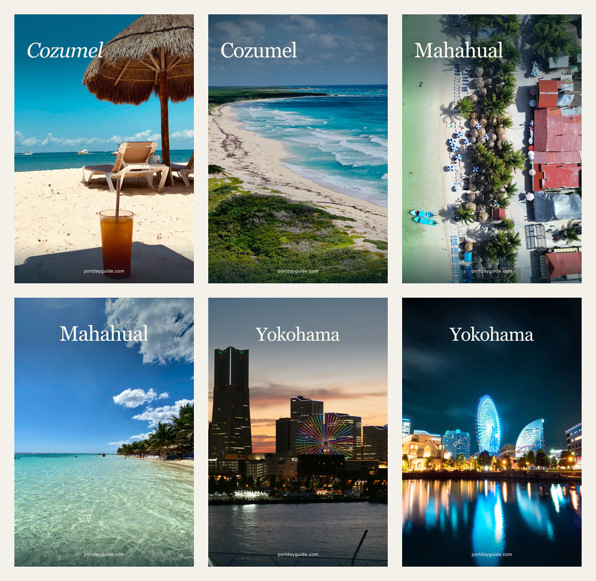

# PortdayGuide: six scenic Pinterest drafts

**Review only. No Pin is published or scheduled by this change.** Six finished 1000 x 1500 PNGs, English publishing copy, direct destinations, photo rights and a staged publication plan are included. The application, live RSS, existing images, GUIDs, dates and automation schedules are unchanged.



## November 1 visual revision

Recomposed the same six draft identities after the owner requested a more Instagram-style travel editorial look. Six different real photographs fill the frame: Cozumel beach and sweeping coast, Mahahual from above and at water level, Yokohama sunset and illuminated waterfront reflections. The latest owner direction removes all promotional overlay copy and on-image credits. Each image contains exactly the accurate place name (Cozumel, Mahahual or Yokohama) in Georgia and a much smaller portdayguide.com mark. The six photographs and their distinct views are retained, with only localized transparent gradients for legibility. No scenery was generated, replaced or retouched.

New photo selection required new source files because the original taxi/terminal/promenade images did not deliver the requested scenic appeal. [Photo source register](photo-sources.json) records the verified primary source pages, photographer, location, platform license, download URL and download checksum. The six local WebP inputs are in the sources directory; these are draft inputs, not a stock photo collection or a claim that these new sources already appear in the site's public rights register. Source and license pages were checked November 1, 2026. The [Unsplash License](https://unsplash.com/license) and [Pexels License](https://www.pexels.com/license/) do not require on-image attribution. Each final publishing description retains the photographer, source URL, license URL and a crop/gradient/type modification notice; no photo replacement was necessary.

The revisions do not constitute approval to publish. PR #45 stays draft. Existing six IDs, destination parameters, anchors, proposed order and null actual publication fields are retained. All live files and operating schedules remain unchanged.

## Scope and ownership

The owner requested the proposed Pinterest optimization on October 31: three existing pages, two distinct useful angles each. This is a bounded preparation batch, separate from the completed Costa Maya, Osaka and Cozumel/Yokohama releases. It is not six new articles or a permanent publishing increase.

Prepared against main `91aa1d7de0a81d4bff0f0a29bc9f3c59f9ca2a9c`. Read the current operating/acquisition runbooks, operations log, image registers, actual page implementations and recent PRs. Only unrelated PR #4 was open when preparation began. The existing acquisition task was idle. This branch owns only `docs/pinterest-batches/2026-10-31/`; no other task's files or schedules were changed. The coordinator reviews these finished assets before any feed or social publication.

## Delivery audit

[Technical evidence](technical-audit.json), checked October 31 at 23:38 UTC:

- Production RSS: HTTP 200, **8 items**, byte-for-byte equal to the current main feed builder. Eight destinations and eight images return 200; all eight image bytes match the checkout.
- Three selected landing pages: HTTP 200, correct self-canonical, indexable, working destination anchors and links to photo credits. No page selection change was necessary.
- Existing source parameters remain `pinterest / organic_social / portdayguide_guides`. New drafts use the same convention and one distinct `utm_content` per creative, equal to its immutable ID.
- The acquisition runbook previously recorded six observed Pins. **New owner screenshot evidence on November 1 shows eight cards in the displayed account, including LGB and Osaka.** Their presence in that account view is confirmed. Public logged-out visibility, individual Pin permalinks, actual outbound destinations and conversions remain unverified. No new browser inspection was attempted.
- The previously blocked Pinterest inspection was not retried. Feed availability, robots allowance and owned-page GETs do not prove Pinterestbot retrieval, a successful import, real visits or revenue.
- The existing Osaka feed date is October 20; actual site release was October 31. It is preserved, not treated as its Pinterest publication date. No existing ID, date or image was refreshed to manufacture a new Pin.

## Finished files and verification

- [Publishing copy and preview for each Pin](copy-and-sources.md): exact English title, description, alt text, destination, angle and linked rights.
- [CSV](publishing-copy.csv): review/publishing reference, **not** an automatic Pinterest bulk-upload specification.
- [Manifest](manifest.json): full destinations, image and source SHA-256 hashes, dimensions, credit/license records, publication order and null actual publication fields.
- [Editable brief](pins.json) and [renderer](render.mjs): deterministic native layouts extending the approach used by `scripts/generate-share-cards.mjs`. Verified real photographs are resized/cropped without generative retouching or scene replacement. The renderer uses locally available Georgia and Arial; fonts are not redistributed. No new image service or credentials.
- `assets/`: six full-size PNGs. `contact-sheet.png`: all six at 300 pixels wide, with only place names and small website marks. The contact sheet also has no additional labels or headings.

Rebuild locally with installed repository dependencies:

```sh
node docs/pinterest-batches/2026-10-31/render.mjs
```

The renderer writes only this draft directory. It rejects duplicate live IDs, overlong copy and photo enlargement, decodes every resulting PNG in full, and writes hashes. The two variants per page use different photographs and practical angles in their titles/descriptions. Hooks, instructions and credits appear only in the publishing copy. All six were visually inspected at 1000 x 1500 and in the 300-pixel contact sheet. The large lower text gradients were removed to reveal the scenery; only subtle place-name/footer gradients remain. The November 2 refinement reduces place labels by one visual size step: 126 to 104 px for Yokohama and 140 to 116 px for Cozumel/Mahahual (about 17% smaller). Baselines, alignment, photography, crops, gradients and the 26 px website mark remain unchanged. All six final images contain exactly two typeset text elements. Credits and source/license links are checked in the captions, not the image pixels. Asset validation checks full decodes and hashes, six distinct photos/IDs/UTMs, three pages with two angles, unchanged destinations against the earlier draft and a byte-stable eight-item feed. Every factual promise is supported by the destination implementation identified in `pins.json`. No live fare, savings, selected-date availability, first-hand visit or return guarantee is promised.

## Publication proposal — held for coordinator review

Use the **existing native RSS connection only**, targeting the existing public board **Cruise Port Guides & Tips**. Do not also manually upload these images. The owner review must cover this six-Pin one-time batch allocation; it does not increase recurring quotas or take either new-article Pin reservation. The ordinary existing-page slot is already used by the October 31 Costa Maya release. If this batch allocation is not cleared, keep the drafts held rather than borrowing that slot.

The following are proposed existing acquisition-run slots, **not a scheduled automation**. All are 09:30 America/Chicago (15:30 UTC after the November 1 time change). Do not backdate a missed slot or accumulate catch-up posts. If review finishes later, the coordinator should shift the remaining sequence within the existing authorized period; no task is extended beyond December 13 by this document.

| Order | Proposed slot | Creative | Reason |
| --- | --- | --- | --- |
| 1 | November 2 | `costa-maya-port-or-town-v1` | Start with a page absent from the current feed; test the setting decision. |
| 2 | November 4 | `cozumel-beach-pass-transport-v1` | Specific admission/transport gap, rather than another generic taxi-cost cover. |
| 3 | November 9 | `yokohama-name-your-terminal-v1` | Correct-terminal decision before route selection. |
| 4 | November 16 | `costa-maya-return-budget-v1` | At least 14 days after its first variant; test time and full-cost readiness. |
| 5 | November 18 | `cozumel-driver-inclusions-v1` | At least 14 days after its first variant; test reserved time versus two rides. |
| 6 | November 23 | `tokyo-yokohama-seats-and-bags-v1` | At least 14 days after its first variant; test group/luggage readiness. |

For each cleared slot, the existing acquisition owner must:

1. Re-read main, open PRs and current ownership. Check the ledger, RSS and actual Pinterest evidence for this immutable ID/image/title/destination. A pending or uncertain prior import is not permission to upload it again.
2. Copy **only that Pin** to `/public/media/share/<id>.png`. Add one item to the existing editorial feed list using the exact title, description, path and anchor in `pins.json`, `imagePath: /media/share/<id>.png`, and a factual first-feed-publication timestamp. Retain all earlier entries and dates. Never install this draft manifest as the live feed or add all six at once. No new feed, board or task is necessary.
3. Preserve the full source/license/change information in the public rights record, using the new Pexels/Unsplash source records for this revision. Keep the complete attribution-bearing description, including photographer, source/license links and modification notice. Do not restore extra words or credits onto the image. Native RSS maps title/description/image; it does not establish that custom alt text is imported. Use the supplied alt text only through a supported existing-Pin accessibility field, if available, without recreating the Pin.
4. Apply ordinary scoped PR, CI/preview and production checks once per substantive publication. Keep old feed entries byte-stable. Confirm the intended production image, URL, anchor, canonical and source parameters via GET; do not navigate sponsored links or POST test analytics.
5. Record feed deployment separately from the observed Pin ID, URL, board and actual publication timestamp. Pinterest says RSS imports may take up to 24 hours. If import remains unverified, keep it pending and pause further expansion; do not reset the GUID/date or add a manual duplicate. Verify `Visit site`'s destination by reading its href, without creating a test affiliate click.

The owner has already supplied the eight-card account view; do not request that screenshot again. The remaining smallest account-evidence handoff is the **Copy link** permalink for an existing card (including LGB/Osaka as needed), followed by reading its actual destination in an authorized account session. An account owner can inspect native RSS status only if a specific pending import needs diagnosis. No new account, domain claim or RSS connection is needed. A Pinterest analytics export becomes necessary for a traffic assessment, not for finishing these drafts. Do not ask again for previously supplied account setup or unrelated financial files.

## What to measure

The goal is qualified visits and affiliate earnings. Impressions/saves are diagnostic context, not the success criterion. Start each creative's observation clock from its **verified actual Pin publication**, not this draft date, its proposed slot or RSS date. Compare equal 28- and 56-complete-day windows and state source timezone/coverage. Use existing review tasks only; a future window outside their authorized end date remains an explicit handoff, not a new schedule.

| Outcome | Evidence required | Current limit |
| --- | --- | --- |
| Pinterest outbound clicks per Pin | Native Analytics export or actual Pin analytics with date range/timezone and Pin ID | Not read in this task. Pin closeup clicks are a different metric. |
| External website visits | A verified existing analytics source that actually measures visits/referrals | Not available here. Do not rename `page_arrival` events as external visits, sessions or people. |
| Planning activity | Existing private report, after runtime persistence and freshness are verified | Cozumel and Tokyo guides have arrival/tool events; Costa Maya has no arrival coverage in this pilot. Missing history/coverage is not zero. |
| Pinterest-labeled affiliate actions | Existing current-page `source=pinterest` click rows, correct page/campaign and complete dates | Aggregate events, not visitors. `utm_content` is **not stored** by this collector, so downstream per-Pin attribution is unavailable. Source can be lost after internal navigation. |
| Orders and earnings | Matching Viator campaign reports, separated into bookings, cancellations, confirmed commission and cash paid | Page-campaign reporting cannot prove which Pin caused an order. No new financial report or earnings read occurred. |

Keep private reports and counts out of this public directory. At 28 days, check actual outbound demand and useful on-site activity where supported. At 56 days, retain or stop the channel/angle based on verified traffic, affiliate results and maintenance cost; small samples or unavailable data do not justify a winner or more volume. These staged variants are a directional test, not a randomized causal experiment.

## Official references

- [RSS import requirements and title/description mapping](https://help.pinterest.com/en/business/article/auto-publish-pins-from-your-rss-feed), read October 31, 2026.
- [Original content, 2:3 imagery, matched landing pages and duplicate avoidance](https://help.pinterest.com/en/business/article/pin-performance-and-distribution), read October 31, 2026.
- [Pinterest Analytics metrics](https://help.pinterest.com/en/business/article/pinterest-analytics), read October 31, 2026.

No paid tools, accounts, credentials, advertisements, outreach or recurring automations were added. The canceled competitor outreach remains canceled.
