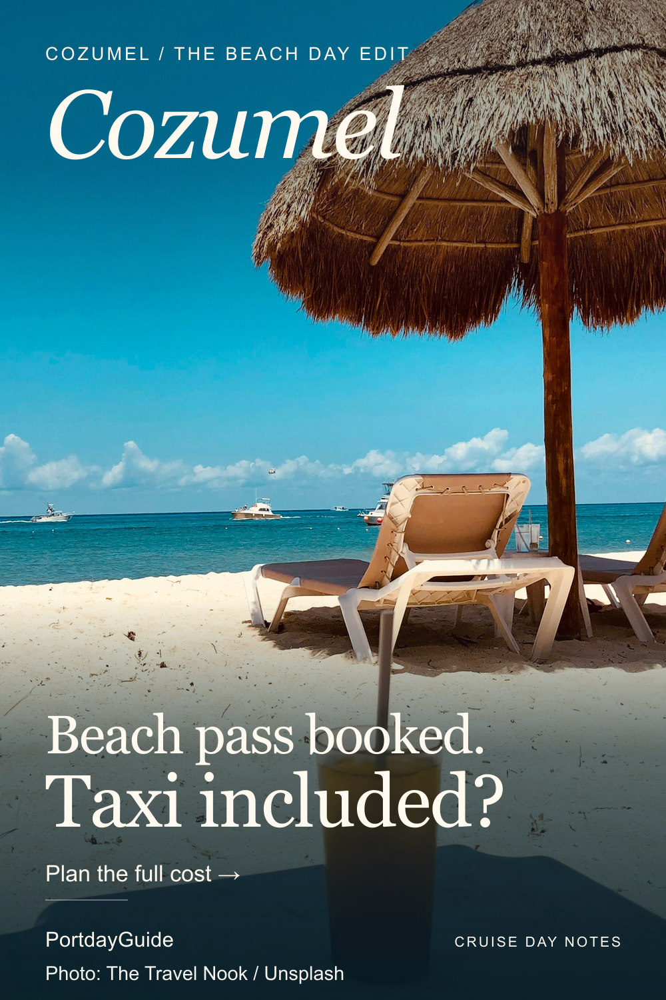
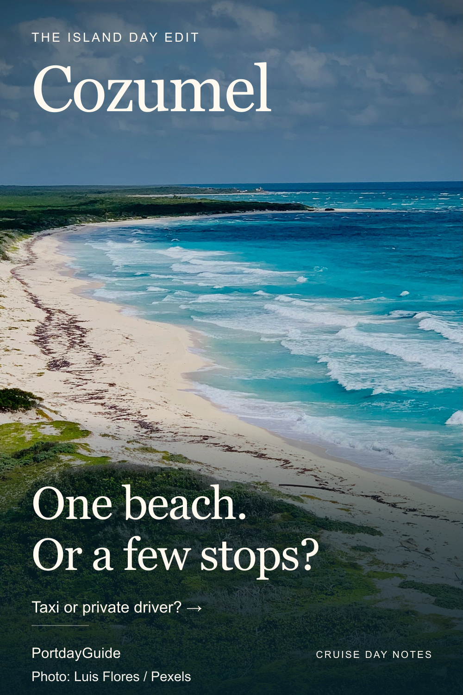
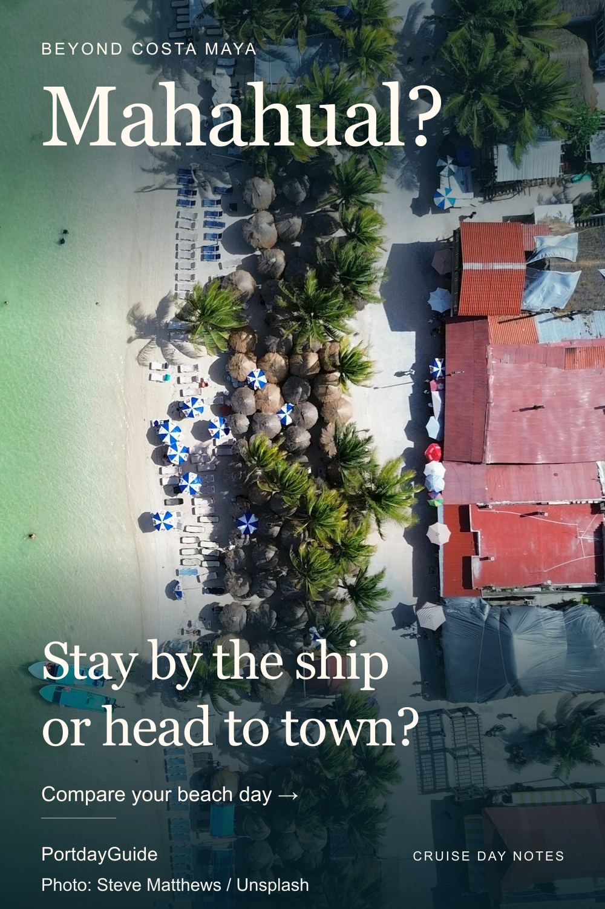
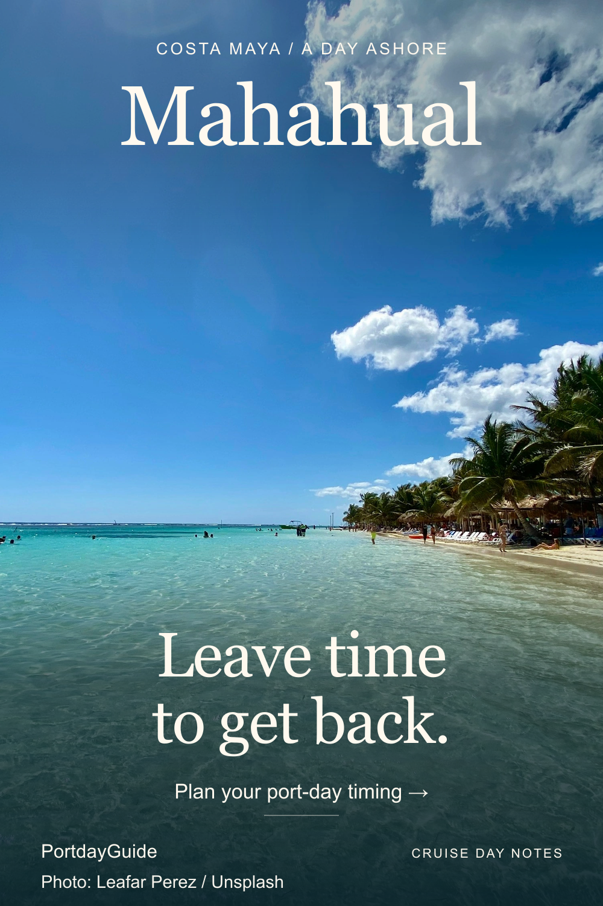
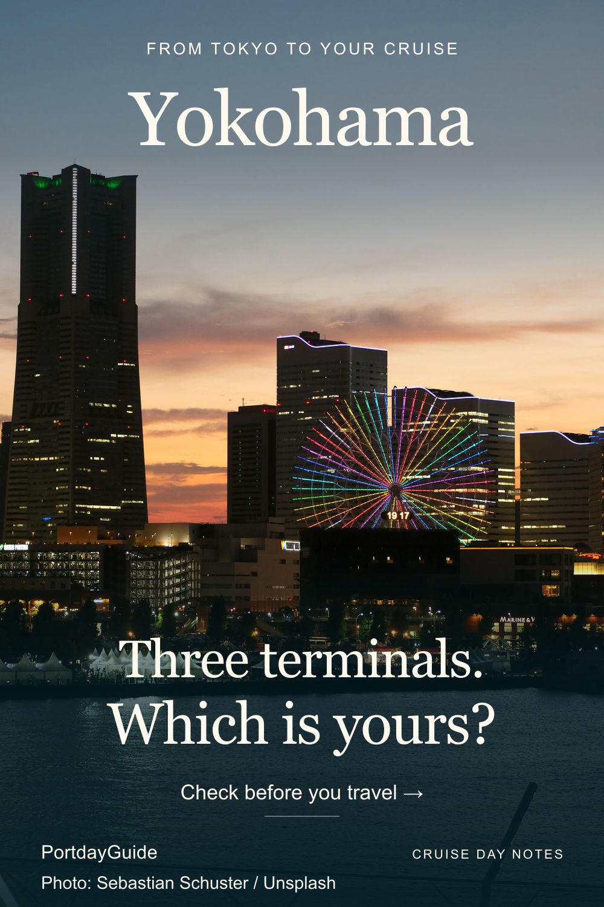
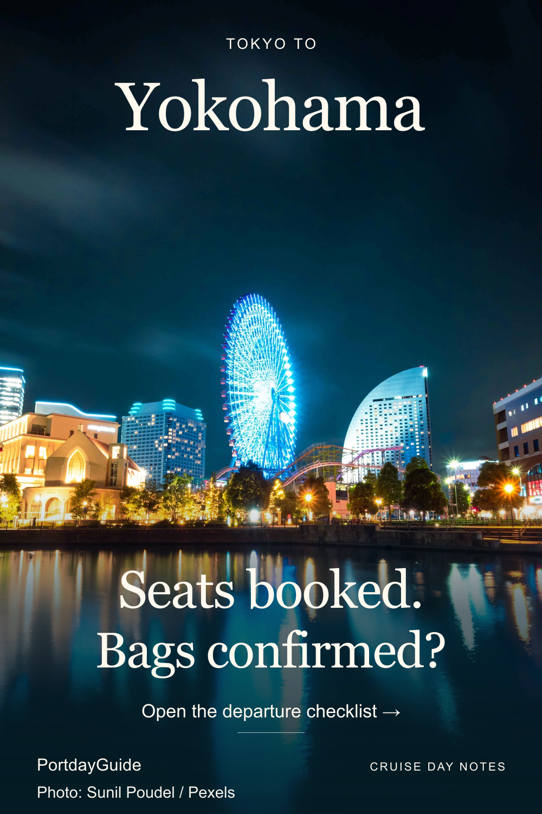

# Exact publishing copy and image rights

Six revised scenic drafts, November 1, 2026. No actual Pin URL or publication date exists. Use the original 1000 x 1500 PNGs, not the contact-sheet thumbnails. Full-bleed real photographs, short editorial headlines and transparent gradients replace the earlier card layouts.

## 01 — Cozumel beach pass booked: does it include your taxi?

- **ID:** `cozumel-beach-pass-transport-v1`
- **Board:** [Cruise Port Guides & Tips](https://www.pinterest.com/portdayguide/cruise-port-guides-tips/)
- **Destination:** [Open the relevant guide](https://portdayguide.com/ports/cozumel/taxi-rates?utm_source=pinterest&utm_medium=organic_social&utm_campaign=portdayguide_guides&utm_content=cozumel-beach-pass-transport-v1#cozumel-fare-references)
- **Title:** Cozumel beach pass booked: does it include your taxi?
- **Description:** Your Cozumel beach pass may leave two taxi rides to arrange. Check outward and return transport before adding admission, then compare your own quotes in the free group-cost calculator. No live fare or savings guarantee. Photo: The Travel Nook / Unsplash, Nachi Cocom beach (2018), cropped with type; scenery is not a promise of current pass inclusions. Guide includes affiliate booking links.
- **Alt text:** Thatched beach umbrella, loungers and turquoise sea at Nachi Cocom, Cozumel. Text: Cozumel, the beach day edit. Beach pass booked. Taxi included? Plan the full cost. Photo by The Travel Nook.
- **Decision:** Avoid buying admission while overlooking two separate taxi rides.
- **Landing-page support:** components/CozumelTaxiArticle.tsx: beach-pass exclusions and separate return quote, followed by the group-cost tool.
- **Release order:** 2; held for review.

Photo: **The Travel Nook**, [Nachi Cocom beach, Cozumel](https://unsplash.com/photos/2FoqQ0EPwLg), [Unsplash License](https://unsplash.com/license). Source-page date: 2018-05-25; not a current-conditions promise. Source/license verified 2026-11-01. The source page identifies the photographer and destination and labels the image free under the linked license. Both platform licenses permit free commercial use and modification; courtesy credit is retained. No endorsement is implied.

Local input: [cozumel_beach](sources/cozumel_beach.webp), 3000 x 2250, SHA-256 `efd4b483d8f9173aba711767cac403a9e34db3df735eaeda300dbfd4081903ea`. The [source register](photo-sources.json) also records the downloaded file checksum, dimensions and exact download URL.

**Processing:** Proportional downsize, WebP encoding, portrait crop, separate translucent gradients and typography. No photograph enlargement, generation, scene replacement or retouching. Skyline photographs show the destination, not a specific cruise terminal or pickup location.

**Composition:** Original typography/layout by PortdayGuide; photographs retain their listed platform licenses.

## 02 — Cozumel taxi or private driver? Compare the same day

- **ID:** `cozumel-driver-inclusions-v1`
- **Board:** [Cruise Port Guides & Tips](https://www.pinterest.com/portdayguide/cruise-port-guides-tips/)
- **Destination:** [Open the relevant guide](https://portdayguide.com/ports/cozumel/taxi-rates?utm_source=pinterest&utm_medium=organic_social&utm_campaign=portdayguide_guides&utm_content=cozumel-driver-inclusions-v1#transport-budget-title)
- **Title:** Cozumel taxi or private driver? Compare the same day
- **Description:** One beach or several Cozumel stops? Compare two taxi rides with reserved driver time for the same party and route. Check included hours, waiting, admissions and the return, then enter complete quotes in the free calculator. No live fare or savings guarantee. Coastal photo: Luis Flores / Pexels (2023), cropped with type. Guide includes affiliate booking links.
- **Alt text:** Sweeping Cozumel coastline with pale sand, blue water and green coastal vegetation. Text: Cozumel. One beach. Or a few stops? Taxi or private driver? Photo by Luis Flores.
- **Decision:** Distinguish point-to-point rides from a block of driver time before comparing totals.
- **Landing-page support:** components/CozumelTaxiArticle.tsx: one destination, several stops, quote inclusions; components/CozumelTransportBudget.tsx.
- **Release order:** 5; held for review.

Photo: **Luis Flores**, [San Miguel de Cozumel, Q.R., Mexico](https://www.pexels.com/photo/beach-by-caribbean-sea-16846471/), [Pexels License](https://www.pexels.com/license/). Source-page date: 2023-05-16; not a current-conditions promise. Source/license verified 2026-11-01. The source page identifies the photographer and destination and labels the image free under the linked license. Both platform licenses permit free commercial use and modification; courtesy credit is retained. No endorsement is implied.

Local input: [cozumel_aerial](sources/cozumel_aerial.webp), 1688 x 3000, SHA-256 `b9ecce9d11fadaa43f1debefb3d4559f3dffee8fa8d7427463ba022d771d604b`. The [source register](photo-sources.json) also records the downloaded file checksum, dimensions and exact download URL.

**Processing:** Proportional downsize, WebP encoding, portrait crop, separate translucent gradients and typography. No photograph enlargement, generation, scene replacement or retouching. Skyline photographs show the destination, not a specific cruise terminal or pickup location.

**Composition:** Original typography/layout by PortdayGuide; photographs retain their listed platform licenses.

## 03 — Costa Maya port or Mahahual? Choose your cruise-day setting

- **ID:** `costa-maya-port-or-town-v1`
- **Board:** [Cruise Port Guides & Tips](https://www.pinterest.com/portdayguide/cruise-port-guides-tips/)
- **Destination:** [Open the relevant guide](https://portdayguide.com/ports/costa-maya/port-vs-mahahual?utm_source=pinterest&utm_medium=organic_social&utm_campaign=portdayguide_guides&utm_content=costa-maya-port-or-town-v1#quick-answer-title)
- **Title:** Costa Maya port or Mahahual? Choose your cruise-day setting
- **Description:** A Costa Maya cruise day can mean staying in the port complex or taking a taxi to the beachfront town of Mahahual. Compare the atmosphere, mobility needs, weather fallback and transport each way before choosing. Photo shows Mahahual, not the port complex: Steve Matthews / Unsplash (2026), cropped with type. Guide includes affiliate booking links.
- **Alt text:** Overhead view of Mahahual with shallow green-blue water, beach and waterfront buildings. Text: Beyond Costa Maya. Mahahual? Stay by the ship or head to town? Compare your beach day. Photo by Steve Matthews.
- **Decision:** Compare staying in the port complex with a taxi trip to the beachfront town shown in the photograph.
- **Landing-page support:** lib/port-intent-guides.ts: port-vs-mahahual quick answer, traveler types and side-by-side comparison.
- **Release order:** 1; held for review.

Photo: **Steve Matthews**, [Costa Maya, Mahahual, Quintana Roo, Mexico](https://unsplash.com/photos/WxlfTD4vTwU), [Unsplash License](https://unsplash.com/license). Source-page date: 2026-08-20; not a current-conditions promise. Source/license verified 2026-11-01. The source page identifies the photographer and destination and labels the image free under the linked license. Both platform licenses permit free commercial use and modification; courtesy credit is retained. No endorsement is implied.

Local input: [mahahual_aerial](sources/mahahual_aerial.webp), 3000 x 1688, SHA-256 `37f814242088c85f32e71f14e85990ec62e250ecec98fba51a41ad1ba03b7f03`. The [source register](photo-sources.json) also records the downloaded file checksum, dimensions and exact download URL.

**Processing:** Proportional downsize, WebP encoding, portrait crop, separate translucent gradients and typography. No photograph enlargement, generation, scene replacement or retouching. Skyline photographs show the destination, not a specific cruise terminal or pickup location.

**Composition:** Original typography/layout by PortdayGuide; photographs retain their listed platform licenses.

## 04 — Mahahual beach day from Costa Maya: plan your return first

- **ID:** `costa-maya-return-budget-v1`
- **Board:** [Cruise Port Guides & Tips](https://www.pinterest.com/portdayguide/cruise-port-guides-tips/)
- **Destination:** [Open the relevant guide](https://portdayguide.com/ports/costa-maya/port-vs-mahahual?utm_source=pinterest&utm_medium=organic_social&utm_campaign=portdayguide_guides&utm_content=costa-maya-return-budget-v1#quick-answer-title)
- **Title:** Mahahual beach day from Costa Maya: plan your return first
- **Description:** Before your Mahahual beach day from Costa Maya, allow for the pier walk and return journey. Budget both taxi rides and any beach minimum spend or day pass, then set a leave-the-beach alarm. Use the comparison guide to decide whether this day fits your time ashore. Beach photo: Leafar Perez / Unsplash (2020), cropped with type; conditions vary. Guide includes affiliate booking links.
- **Alt text:** Clear shallow water and a palm-lined beach in Mahahual. Text: Costa Maya, a day ashore. Mahahual. Leave time to get back. Plan your port-day timing. Photo by Leafar Perez.
- **Decision:** Time and full-cost readiness before leaving port, rather than a general beach recommendation.
- **Landing-page support:** lib/port-intent-guides.ts: port-vs-mahahual steps Check the usable window, Price the full choice, Protect the return.
- **Release order:** 4; held for review.

Photo: **Leafar Perez**, [Mahahual beach; Calle Malecon, Mexico](https://unsplash.com/photos/1iFNLNoa9gQ), [Unsplash License](https://unsplash.com/license). Source-page date: 2020-06-30; not a current-conditions promise. Source/license verified 2026-11-01. The source page identifies the photographer and destination and labels the image free under the linked license. Both platform licenses permit free commercial use and modification; courtesy credit is retained. No endorsement is implied.

Local input: [mahahual_palms](sources/mahahual_palms.webp), 3000 x 2250, SHA-256 `ed77a51d41468aedf4f49ed2b491008fd71a842229407ac3c46a7b6eff131fe2`. The [source register](photo-sources.json) also records the downloaded file checksum, dimensions and exact download URL.

**Processing:** Proportional downsize, WebP encoding, portrait crop, separate translucent gradients and typography. No photograph enlargement, generation, scene replacement or retouching. Skyline photographs show the destination, not a specific cruise terminal or pickup location.

**Composition:** Original typography/layout by PortdayGuide; photographs retain their listed platform licenses.

## 05 — Tokyo to Yokohama cruise port: which of the three terminals?

- **ID:** `yokohama-name-your-terminal-v1`
- **Board:** [Cruise Port Guides & Tips](https://www.pinterest.com/portdayguide/cruise-port-guides-tips/)
- **Destination:** [Open the relevant guide](https://portdayguide.com/ports/yokohama-tokyo/tokyo-to-yokohama-cruise-terminal?utm_source=pinterest&utm_medium=organic_social&utm_campaign=portdayguide_guides&utm_content=yokohama-name-your-terminal-v1#confirm-yokohama-terminal)
- **Title:** Tokyo to Yokohama cruise port: which of the three terminals?
- **Description:** Cruising from Yokohama after a stay in Tokyo? Confirm whether your documents name Osanbashi, Shinko or Daikoku before planning the final station, walk or vehicle connection. Open the terminal comparison and free departure checklist. Yokohama skyline: Sebastian Schuster / Unsplash (2025), cropped with type; city scenery is not a terminal entrance. Guide includes affiliate booking links.
- **Alt text:** Yokohama skyline at sunset, including the Landmark Tower and colorful Ferris wheel, shown as city scenery. Text: From Tokyo to your cruise. Yokohama. Three terminals. Which is yours? Check before you travel. Photo by Sebastian Schuster.
- **Decision:** Prevent the wrong terminal choice before booking a Tokyo departure route.
- **Landing-page support:** components/TokyoYokohamaTransferArticle.tsx: confirm-yokohama-terminal table and Daikoku connection guidance.
- **Release order:** 3; held for review.

Photo: **Sebastian Schuster**, [Yokohama, Kanagawa, Japan](https://unsplash.com/photos/DBr7MB-nVnA), [Unsplash License](https://unsplash.com/license). Source-page date: 2025-08-14; not a current-conditions promise. Source/license verified 2026-11-01. The source page identifies the photographer and destination and labels the image free under the linked license. Both platform licenses permit free commercial use and modification; courtesy credit is retained. No endorsement is implied.

Local input: [yokohama_sunset](sources/yokohama_sunset.webp), 2250 x 3000, SHA-256 `b6b465f468d65a6a5344503b44876fe1539b2b07869d473655f09f147aa8e596`. The [source register](photo-sources.json) also records the downloaded file checksum, dimensions and exact download URL.

**Processing:** Proportional downsize, WebP encoding, portrait crop, separate translucent gradients and typography. No photograph enlargement, generation, scene replacement or retouching. Skyline photographs show the destination, not a specific cruise terminal or pickup location.

**Composition:** Original typography/layout by PortdayGuide; photographs retain their listed platform licenses.

## 06 — Tokyo hotel to Yokohama cruise: confirm seats and bags

- **ID:** `tokyo-yokohama-seats-and-bags-v1`
- **Board:** [Cruise Port Guides & Tips](https://www.pinterest.com/portdayguide/cruise-port-guides-tips/)
- **Destination:** [Open the relevant guide](https://portdayguide.com/ports/yokohama-tokyo/tokyo-to-yokohama-cruise-terminal?utm_source=pinterest&utm_medium=organic_social&utm_campaign=portdayguide_guides&utm_content=tokyo-yokohama-seats-and-bags-v1#tokyo-transfer-checklist)
- **Title:** Tokyo hotel to Yokohama cruise: confirm seats and bags
- **Description:** Before your Tokyo hotel-to-Yokohama cruise transfer, confirm every traveler and suitcase, child or mobility needs, pickup, exact terminal and full price. Work backward from your cruise check-in window with the free six-item checklist. Yokohama waterfront: Sunil Poudel / Pexels (2020), cropped with type; scenery is not a pickup point. Guide includes affiliate booking links.
- **Alt text:** Yokohama waterfront at night, with an illuminated Ferris wheel and blue and gold reflections. Text: Tokyo to Yokohama. Seats booked. Bags confirmed? Open the departure checklist. Photo by Sunil Poudel.
- **Decision:** Vehicle capacity and departure readiness for a travel group with luggage.
- **Landing-page support:** components/TokyoTransferChecklist.tsx: six checkable items, print and share controls; TokyoYokohamaTransferArticle luggage/cost/arrival sections.
- **Release order:** 6; held for review.

Photo: **Sunil Poudel**, [Yokohama, Japan](https://www.pexels.com/photo/night-view-of-yokohama-city-5615414/), [Pexels License](https://www.pexels.com/license/). Source-page date: 2020-10-16; not a current-conditions promise. Source/license verified 2026-11-01. The source page identifies the photographer and destination and labels the image free under the linked license. Both platform licenses permit free commercial use and modification; courtesy credit is retained. No endorsement is implied.

Local input: [yokohama_reflections](sources/yokohama_reflections.webp), 2400 x 3000, SHA-256 `a78c2507cd4222e117087f11baadd2d2c18a1aa1d1d724e36375339589d4f361`. The [source register](photo-sources.json) also records the downloaded file checksum, dimensions and exact download URL.

**Processing:** Proportional downsize, WebP encoding, portrait crop, separate translucent gradients and typography. No photograph enlargement, generation, scene replacement or retouching. Skyline photographs show the destination, not a specific cruise terminal or pickup location.

**Composition:** Original typography/layout by PortdayGuide; photographs retain their listed platform licenses.

## Reuse and publication

Keep this record with the batch. Photographs retain their Pexels/Unsplash licenses; the previous draft's CC-licensed photos are no longer used by these six images. Do not carry the old share-alike attribution onto these replacement compositions. Before any eventual feed release, the existing publication owner must add the new photograph/source/license/crop records to the public rights directory and preserve visible author credit and attribution-bearing descriptions. The new source records are not yet deployed to the public site. The board, tracking IDs and canonical destinations remain unchanged. The CSV is publishing copy, not an automatic upload file. Custom alt text import through RSS is not established; use an authorized existing-Pin accessibility field if supported.
